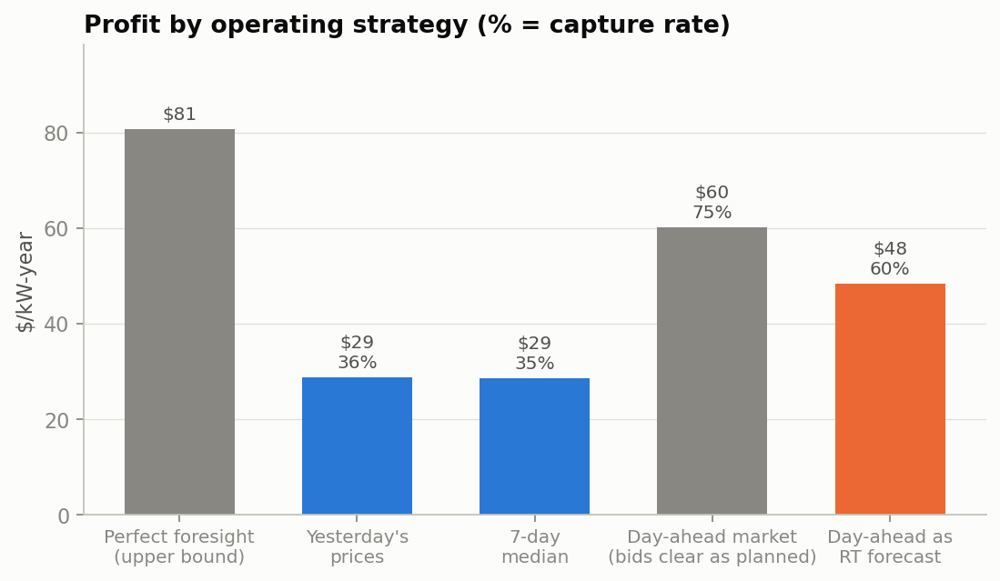
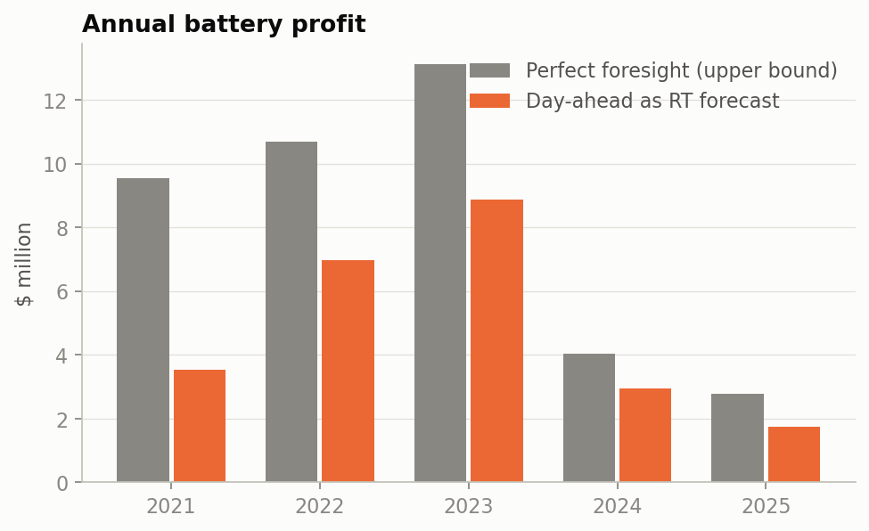
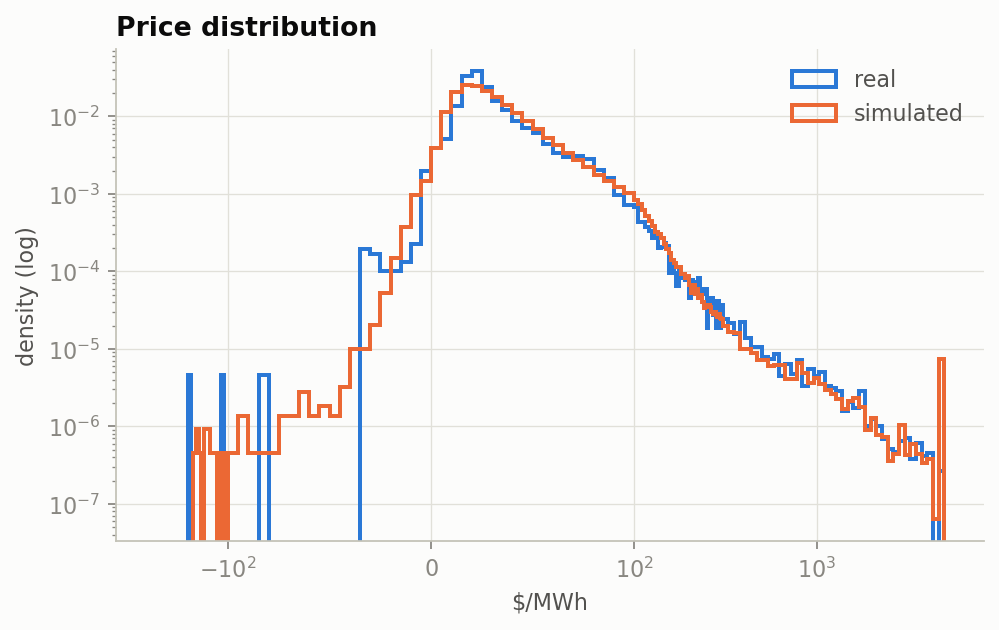
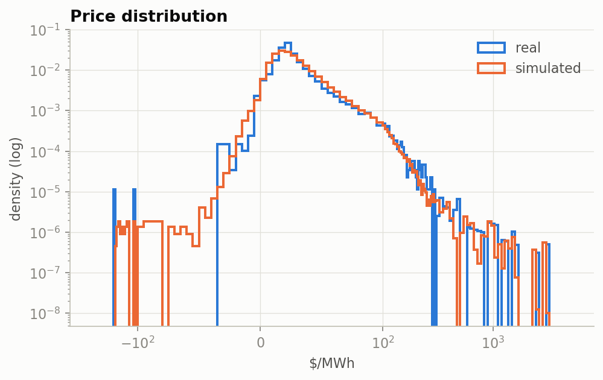
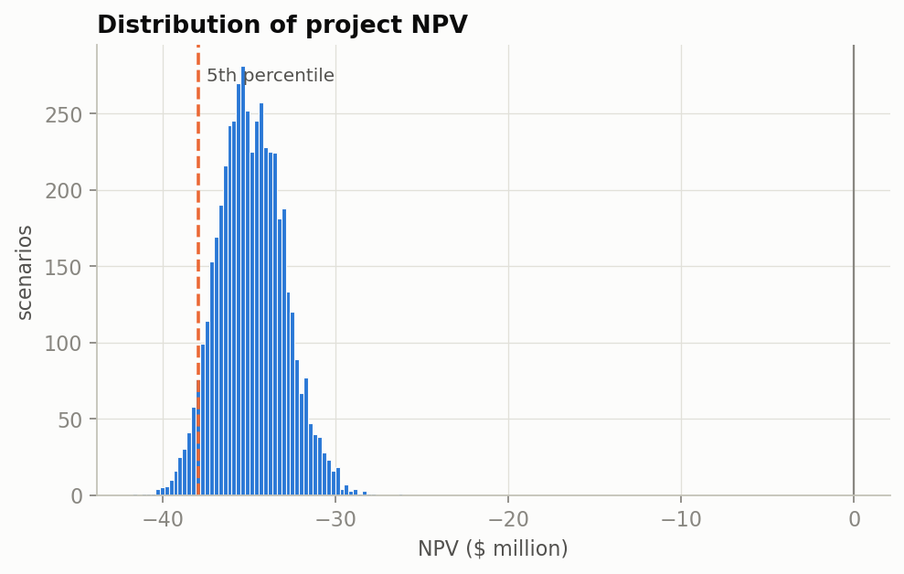
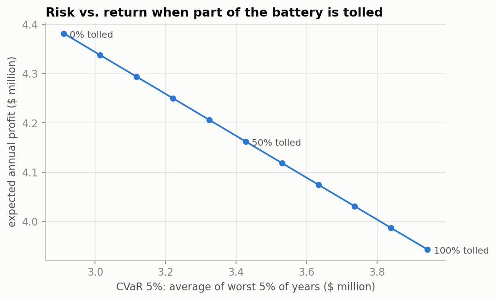

# Results summary
_Generated 2026-11-17 by `scripts/06_summary.py`. Re-run it after any change._

## Setup
- Market: ERCOT, hub **HB_HOUSTON**, hourly real-time prices 2021–2025
- Battery: **100 MW / 200 MWh** (2-hour), round-trip efficiency 88%, degradation cost $15/MWh discharged
- Finance: capex $300/kWh, fixed O&M $10/kW-yr, 15-year life, 8% discount rate, 2%/yr capacity fade

## Key findings
1. **Upper bound:** with perfect foresight the battery earns **$81/kW-year** ($8.1M/year).
2. **Realistic operation:** the best fully realistic strategy (day-ahead prices as real-time forecast) earns **$48/kW-year**, a capture rate of **60%**.
3. **Forecast quality matters:** using day-ahead prices as the forecast captures 60%, vs. 36% with yesterday's prices.
4. **Shrinking spreads:** perfect-foresight profit peaked at $13.1M in 2023 and was $2.8M in 2025.
5. **Winter Storm Uri:** one week produced **42%** of the year's perfect-foresight profit.
6. **Valuation (all years):** expected NPV $-34.9M, P(NPV < 0) = 100%, break-even capex **$125/kWh** vs. $300/kWh assumed. With 2024+ prices only: break-even **$32/kWh**.

_Why NPV can be negative: the model counts only energy arbitrage. Real ERCOT batteries also earn ancillary-service revenue (regulation, reserves), which is not modeled here._

## Operating strategies
| strategy | profit_per_year | profit_per_kw_year | cycles_per_year | paid_at | capture_rate |
|---|---|---|---|---|---|
| Perfect foresight (upper bound) | $8.1M | $80.7 | 325 | real-time | 100% |
| Yesterday's prices as forecast | $2.9M | $28.8 | 325 | real-time | 36% |
| 7-day median as forecast | $2.9M | $28.6 | 245 | real-time | 35% |
| Day-ahead market (bids clear as planned) | $6.0M | $60.2 | 321 | day-ahead | 75% |
| Day-ahead prices as real-time forecast | $4.8M | $48.4 | 321 | real-time | 60% |

## Profit by year
| year | Perfect foresight (upper bound) | Day-ahead prices as real-time forecast |
|---|---|---|
| 2021 | $9.6M | $3.5M |
| 2022 | $10.7M | $7.0M |
| 2023 | $13.1M | $8.9M |
| 2024 | $4.0M | $3.0M |
| 2025 | $2.8M | $1.7M |

## Stress test: Winter Storm Uri
| strategy | profit_in_window | profit_full_year | share_of_year_pct |
|---|---|---|---|
| Perfect foresight (upper bound) | $4.0M | $9.6M | 42% |
| Yesterday's prices as forecast | $-0.5M | $1.3M | -36% |
| 7-day median as forecast | $-0.7M | $0.3M | -242% |
| Day-ahead market (bids clear as planned) | $3.4M | $5.9M | 58% |
| Day-ahead prices as real-time forecast | $0.6M | $3.5M | 18% |

## Sensitivities (perfect foresight)
**duration_h**

| duration_h | profit_per_kw_year | profit_per_kwh_year | cycles_per_year |
|---|---|---|---|
| 1 | $49.4 | $49.4 | 379 |
| 2 | $80.4 | $40.2 | 324 |
| 4 | $116.0 | $29.0 | 250 |
| 6 | $134.3 | $22.4 | 201 |

**round_trip_eff**

| round_trip_eff | profit_per_kw_year | profit_per_kwh_year | cycles_per_year |
|---|---|---|---|
| 0.8 | $75.3 | $37.7 | 285 |
| 0.85 | $78.5 | $39.2 | 310 |
| 0.88 | $80.4 | $40.2 | 324 |
| 0.92 | $83.0 | $41.5 | 344 |

**degradation_cost**

| degradation_cost | profit_per_kw_year | profit_per_kwh_year | cycles_per_year |
|---|---|---|---|
| 0 | $94.2 | $47.1 | 712 |
| 5 | $88.3 | $44.2 | 496 |
| 15 | $80.4 | $40.2 | 324 |
| 30 | $72.7 | $36.3 | 205 |
| 50 | $66.2 | $33.1 | 129 |

## Price model validation (all years)
|  | real | simulated |
|---|---|---|
| mean | 65.86 | 56.85 |
| median | 25.55 | 27.61 |
| p5 | 8.59 | 6.83 |
| p95 | 88.66 | 94.65 |
| p99 | 438.62 | 360.88 |
| pct_negative | 1.44 | 1.53 |
| pct_above_500 | 0.93 | 0.86 |
| mean_daily_spread | 168.41 | 163.26 |
| acf_lag24 | 0.75 | 0.63 |

## Price model validation (2024 onward)
|  | real | simulated |
|---|---|---|
| mean | 29.96 | 29.78 |
| median | 22.98 | 23.47 |
| p5 | 6.12 | 5.08 |
| p95 | 67.78 | 68.12 |
| p99 | 131.22 | 117.99 |
| pct_negative | 1.58 | 1.87 |
| pct_above_500 | 0.11 | 0.11 |
| mean_daily_spread | 84.68 | 82.55 |
| acf_lag24 | 0.15 | 0.07 |

## Valuation
| metric | all years | 2024+ prices |
|---|---|---|
| capex_$/kWh | 300.000 | 300.000 |
| expected_npv_$M | -34.909 | -53.557 |
| npv_p5_$M | -37.947 | -54.565 |
| npv_cvar5_$M | -38.643 | -54.785 |
| prob_npv_negative | 1.000 | 1.000 |
| irr_median | -0.044 | -0.178 |
| irr_p5 | -0.058 | -0.196 |
| irr_p95 | -0.030 | -0.162 |
| breakeven_capex_$/kWh | 125.457 | 32.212 |

## Hedging with a toll
Toll price: $3.29/kW-month (expected merchant profit minus a 10% risk premium). Tolling 50% of the battery lowers expected profit from $4.4M to $4.2M but raises the worst-5% average (CVaR) from $2.9M to $3.4M.

## Extreme events
Removing multi-day spike episodes (> 48 h, like Uri) from the model changes expected annual profit from $4.4M to $4.1M (6% of value), and the 95th-percentile year from $6.1M to $5.2M.

## Resume bullet (check the numbers, then copy)
> Built a stochastic optimization and valuation model for a 100 MW / 200 MWh grid battery on 5 years of ERCOT data (Python, linear programming, Monte Carlo); found a realistic capture rate of 60% of the perfect-foresight value, a break-even capex of $125/kWh, and quantified downside risk (CVaR) and tolling hedges, including a Winter Storm Uri stress test.
